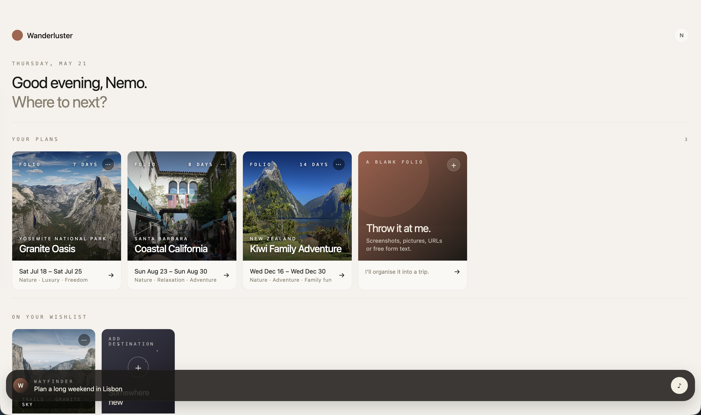
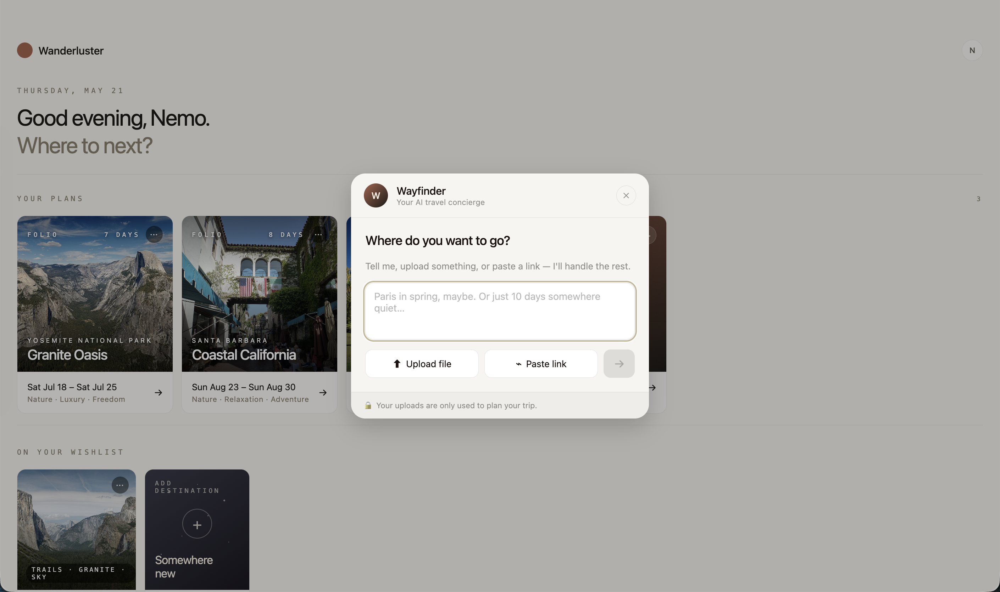
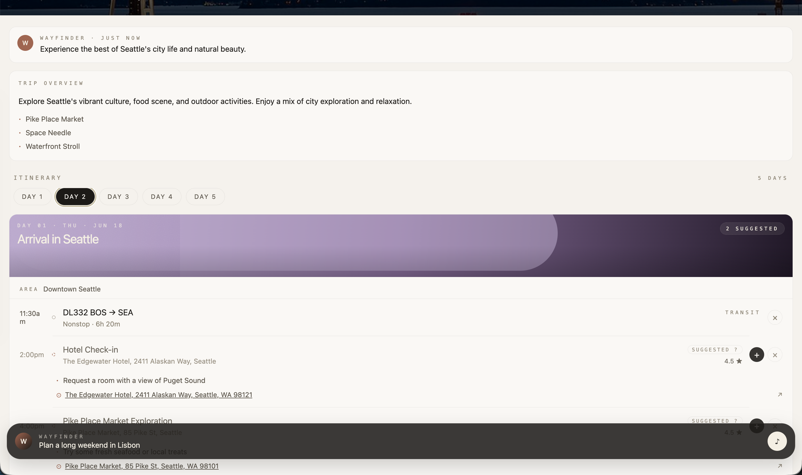
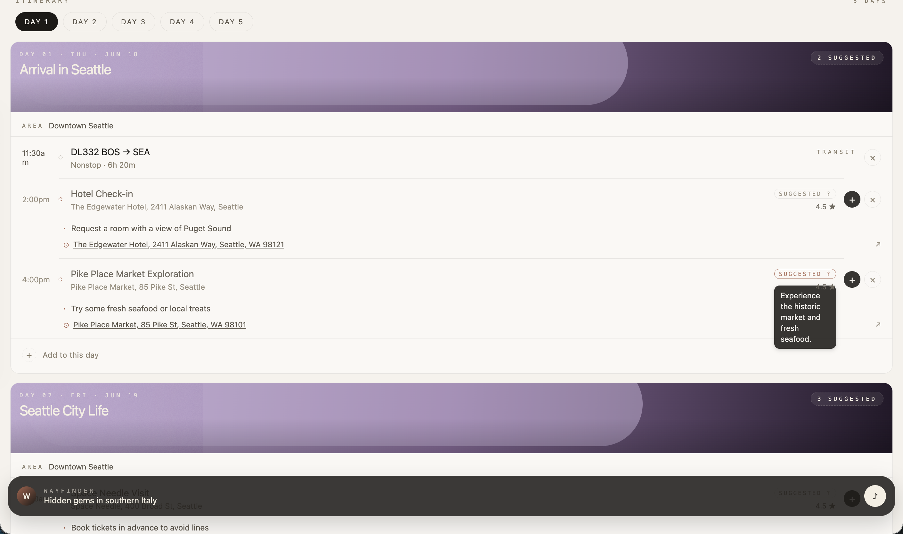
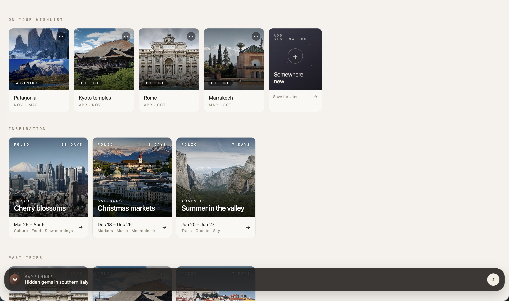
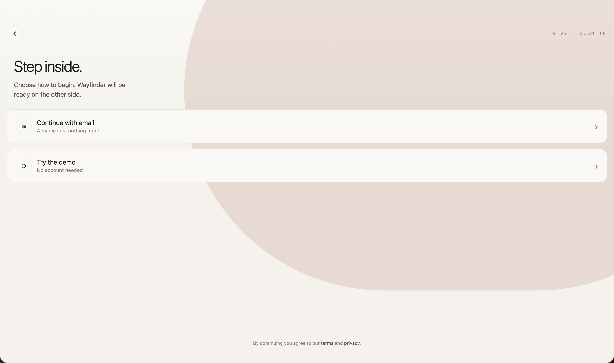

<div align="center">

<br />


<br /><br />

# Wanderluster

**Describe a trip in a sentence. Get back a beautiful, day-by-day plan you'd actually follow.**

<br />

[](https://wanderluster-six.vercel.app)
[](https://expo.dev)
[](https://www.typescriptlang.org)
[](https://groq.com)
[](.github/workflows/evals.yml)

<br />

**▶ Try it now: [wanderluster-six.vercel.app](https://wanderluster-six.vercel.app)** · no account needed

<br />

</div>

---

## Why this exists

Planning a trip means twenty open tabs: a blog post, a Reddit thread, a hotel confirmation, a friend's Google Doc, a map pin you'll never find again. Then you copy it all into a spreadsheet that falls apart the moment plans change.

Wanderluster replaces the tabs with one conversation. Tell **Wayfinder**, the AI concierge, *"10 days in Tokyo, late March, food and culture"*, or paste a blog link, or drop in a screenshot of your booking. A few seconds later you have a **Folio**: a structured, editorial trip plan, laid out day by day, with real venues, real photos and the logistics already thought through.

No forms. No dropdowns. Just say where you want to go.

<br />

## Screenshots

<table>
  <tr>
    <td align="center" width="33%">
      <br />
      <sub><b>Home</b> · folios &amp; wishlist</sub>
    </td>
    <td align="center" width="33%">
      <br />
      <sub><b>Wayfinder</b> · the AI concierge</sub>
    </td>
    <td align="center" width="33%">
      <br />
      <sub><b>Folio</b> · the day-by-day plan</sub>
    </td>
  </tr>
  <tr>
    <td align="center" width="33%">
      <br />
      <sub><b>Day detail</b> · events &amp; venues</sub>
    </td>
    <td align="center" width="33%">
      <br />
      <sub><b>Wishlist</b> · dream destinations</sub>
    </td>
    <td align="center" width="33%">
      <br />
      <sub><b>Sign in</b> · magic link</sub>
    </td>
  </tr>
</table>

<br />

## What it does

**✦ Plan from anything.** Chat, paste a link, upload a PDF or a screenshot. Wayfinder reads what you've already booked and plans around it. If your flights and hotel are sorted, it skips suggesting them and spends its effort on food and things to do.

**✦ Folios, not spreadsheets.** Each trip is a Folio: confirmed and suggested events by day, visa notes, timing tips, map links and a hero photo of the destination. Every hotel, restaurant and activity carries a live venue thumbnail from Google Places.

**✦ Edit by asking.** "Swap Day 3 dinner for something in Shibuya." Wayfinder rewrites just that event and keeps it in the same neighbourhood as the rest of your day.

**✦ Plans that make geographic sense.** Days are clustered by area, so you aren't zig-zagging across a city. Transport is realistic: a train for short hops, a flight with a plausible layover when there's no direct service.

**✦ Remove something, get something better.** Drop an event and Wayfinder suggests a replacement nearby. Your removals feed back into future suggestions.

**✦ A wishlist for someday.** Save dream destinations through the same chat. Wayfinder fills in the best season, typical budget and the vibe.

**✦ Works before you sign up.** The demo is the full product, not a preview. Sign in with a magic link and everything syncs across devices, including what you made as a guest.

<br />

## How it works

```
"10 days in Tokyo, late March, food and culture"
                          │
           Wayfinder · Llama 3.3 70B on Groq
          (screenshots → Llama 4 Scout vision)
                          │
          ┌───────────────┴───────────────┐
   Streaming JSON folio              Streaming chat
          │                         (questions, edits)
   parseCompose: extract, sanitise,
   derive real weekdays from YYYY-MM-DD
          │
   Hero photo (Wikipedia, filtered)  ·  Venue photos (Google Places, proxied)
          │
   Supabase (signed in)  /  localStorage (guest)
          │
   Folio opens, ready to edit
```

### Engineering highlights

- **The AI never decides what day of the week it is.** The model returns ISO dates; `parseCompose.ts` derives weekdays and labels itself. LLMs routinely get "Tuesday, March 25" wrong, and a travel plan with the wrong weekday is worse than no plan.
- **Streaming structured output.** Folios stream in as JSON and are parsed and sanitised before anything is saved, so a half-written or malformed response never becomes a broken trip.
- **Control tags, not free text.** Wayfinder signals intent with `[COMPOSE:]` and `[EDIT:]` tags (including the neighbourhood) that the client strips and routes, keeping the chat readable and the edits precise.
- **One sheet, every mode.** New trip, edit, wishlist and compose-from-file all run through a single `WayfinderSheet` with explicit mode routing, so there's one conversation pattern to learn and to maintain.
- **Dual-mode persistence.** Every store (folios, wishlist, settings) works against Supabase when signed in and `localStorage` as a guest, with a one-time migration on first login. `addFolio()` stays synchronous for instant navigation while the database write happens in the background.
- **Security that's actually wired up.** Every AI route requires a Supabase JWT (guests get an anonymous one) and is rate-limited per user. Link import is SSRF-hardened: https only, private IP ranges blocked, content-type checked, 500 KB cap, 8 s timeout. CSP, HSTS and Cloudflare Turnstile in production. API keys never reach the browser.
- **Evals, not vibes.** A nightly GitHub Actions run scores the deployed app across five suites (hallucination, compose, wayfinder, drift and tool misuse) against a stored baseline, catching invented flights, broken JSON and persona drift before users do.

<br />

## Tech stack

| | |
|---|---|
| **Framework** | [Expo](https://expo.dev) SDK 54 · Expo Router 6 · React Native Web |
| **Language** | TypeScript |
| **AI** | [Groq](https://groq.com) · Llama 3.3 70B (chat and compose) · Llama 4 Scout 17B (vision) |
| **Hosting** | [Vercel](https://vercel.com) (static export + edge functions) |
| **Auth** | [Supabase](https://supabase.com) (magic link + anonymous) |
| **Storage** | Supabase Postgres with row-level security · `localStorage` for guests |
| **Venue photos** | [Google Places API](https://developers.google.com/maps/documentation/places), proxied server-side |
| **Hero photos** | [Wikimedia Commons](https://commons.wikimedia.org) |
| **Bot protection** | [Cloudflare Turnstile](https://www.cloudflare.com/products/turnstile/) |

<br />

## Getting started

**Prerequisites:** Node ≥ 20 and a [Groq API key](https://console.groq.com) (the free tier is enough).

```bash
git clone https://github.com/nehamo-dev/wanderluster.git
cd wanderluster
npm install
```

Create `.env.local`:

```env
GROQ_API_KEY=your_groq_key_here
EXPO_PUBLIC_SUPABASE_URL=https://your-project.supabase.co
EXPO_PUBLIC_SUPABASE_ANON_KEY=your_anon_key_here

# Optional: venue photo thumbnails on events
GOOGLE_MAPS_API_KEY=your_google_maps_key_here

# Optional: Cloudflare Turnstile on login
EXPO_PUBLIC_TURNSTILE_SITE_KEY=your_turnstile_site_key_here
```

```bash
npm run web      # http://localhost:8082
npm run build    # static export to dist/ (must pass with zero TypeScript errors)
npm run eval     # run the AI eval suites against localhost
```

### Deploying

`vercel --prod` after a build. Set `GROQ_API_KEY`, `EXPO_PUBLIC_SUPABASE_URL` and `EXPO_PUBLIC_SUPABASE_ANON_KEY` (required), plus `EXPO_PUBLIC_TURNSTILE_SITE_KEY` and `GOOGLE_MAPS_API_KEY` (recommended). For nightly evals, add `GROQ_API_KEY` and `EVAL_BASE_URL` as repo secrets.

<br />

## Project structure

```
app/
  (app)/index.tsx        home: folios, wishlist, inspiration
  (app)/trip/[id].tsx    folio detail
  api/                   compose · wayfinder · wishlist · suggest · feedback · place-photo
api/                     Vercel edge functions (deployed copies of the routes)
components/
  wayfinder/             WayfinderDock + WayfinderSheet, the one AI surface
  trip/                  DayCard, EventRow (venue photos, map links)
  home/                  folio and wishlist tiles
lib/
  parseCompose.ts        AI output → typed, date-corrected Folio
  api-auth.ts            JWT auth + per-user rate limiting
  *-context.tsx          dual-mode stores (Supabase / localStorage)
evals/                   hallucination · compose · wayfinder · drift · tool-misuse
```

<br />

## Design principles

- **Editorial, not enterprise.** It should feel like a well-made travel journal, not a SaaS dashboard. Warm bone palette, typography first.
- **Real places, real photos.** Every destination image comes from Wikimedia Commons and is verified before shipping. No stock photos.
- **Words matter.** Trips are *Folios*. The AI is *Wayfinder*.
- **Conversation first.** Every creation flow (new trip, wishlist item, edits) goes through Wayfinder. There are no separate forms.

<br />

## Roadmap

- [ ] Price tracking for wishlist destinations
- [ ] Google Calendar sync
- [ ] Gmail import that auto-detects bookings
- [ ] Shared folios and collaborative planning
- [ ] Native iOS and Android apps
- [ ] Offline mode
